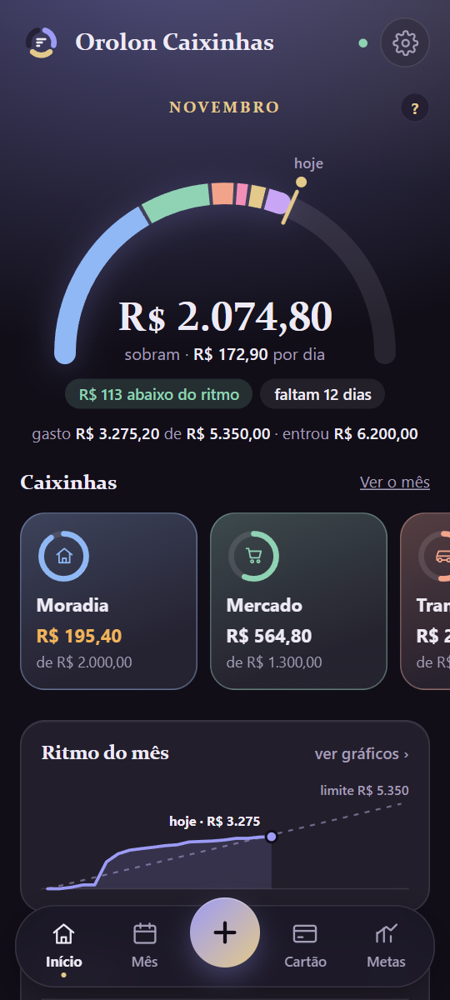
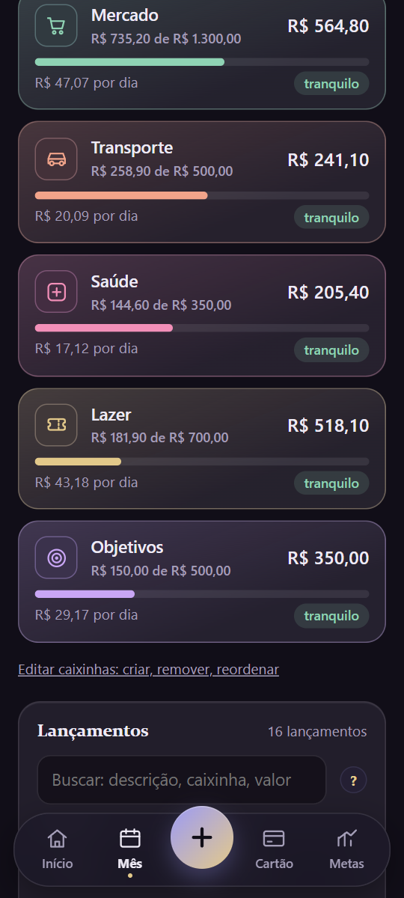
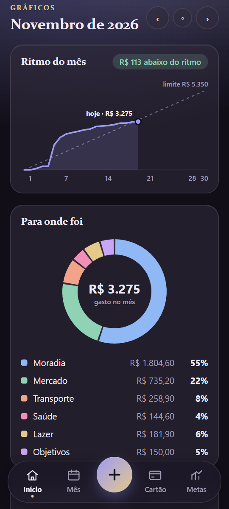
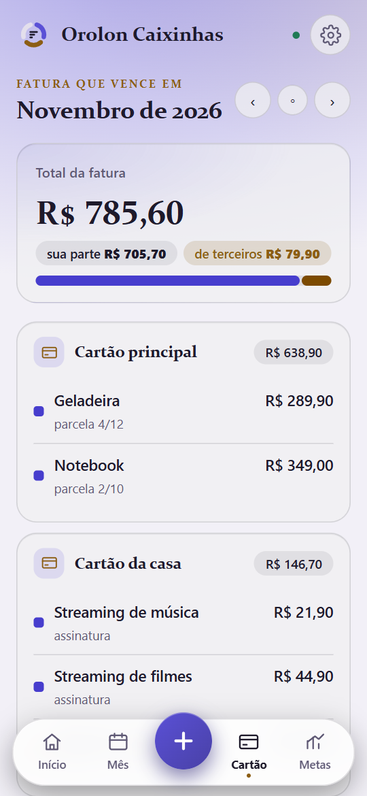
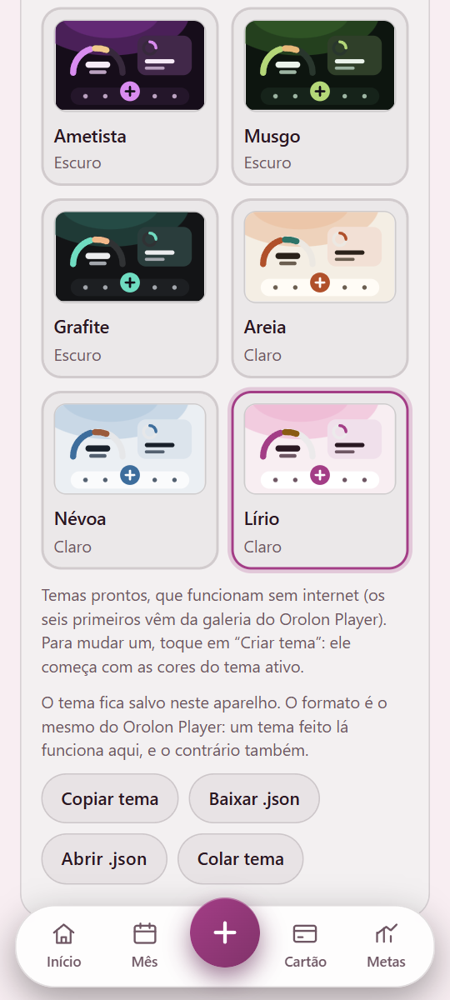
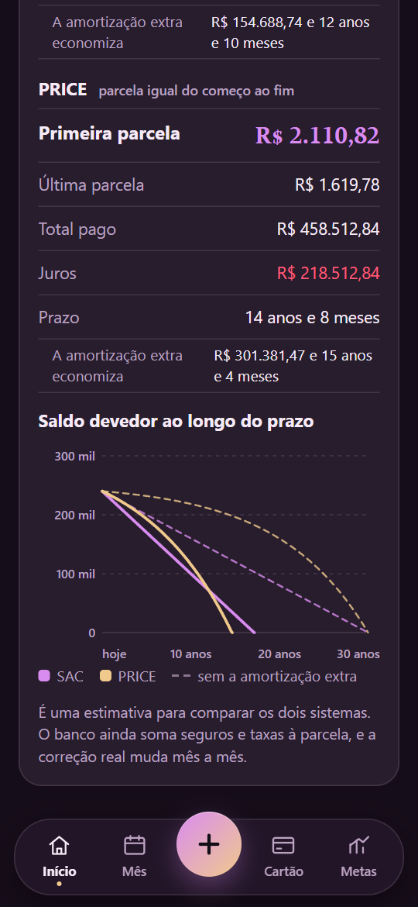
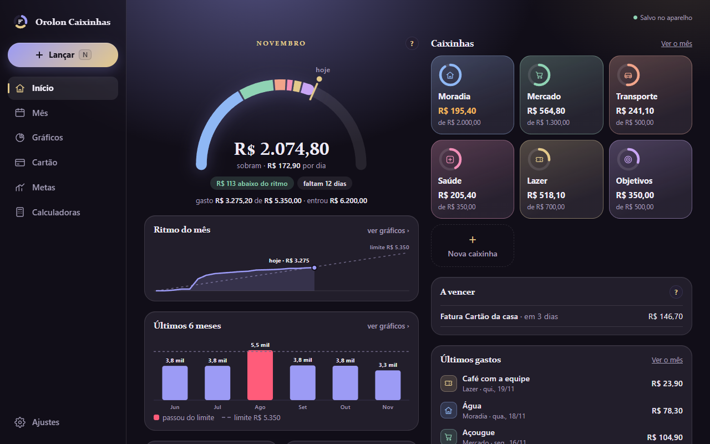
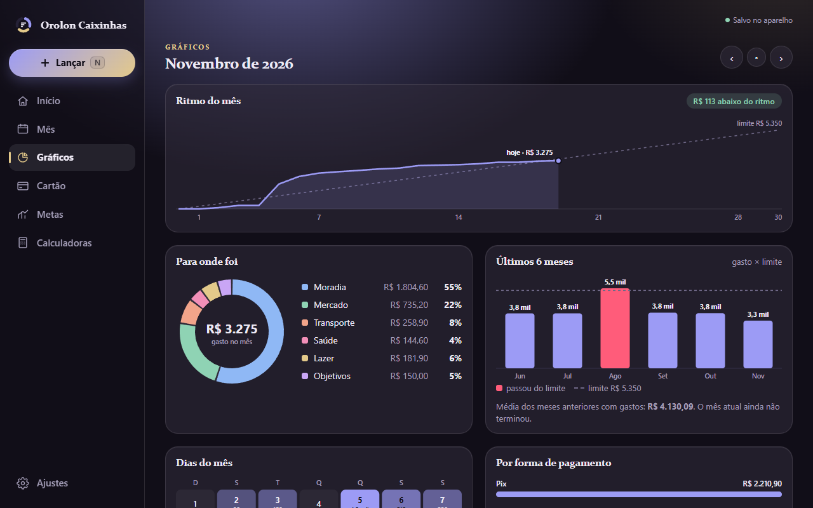

# Orolon Caixinhas

App de finanças pessoais em que o dinheiro do mês fica dividido em **caixinhas com limite**. Tudo em **um único arquivo HTML**: sem servidor, sem conta, sem dependências. Funciona offline, pode ser instalado no celular e no computador (PWA) e tem um app Android.

**[Abrir o app](https://kirarahoshi.github.io/caixinhas-orologias/)**

| Início | Mês | Gráficos |
|---|---|---|
|  |  |  |

| Cartão (tema Orologia Dia) | Temas (tema Lírio) | Calculadoras (tema Ametista) |
|---|---|---|
|  |  |  |

| No computador: Início | No computador: Gráficos |
|---|---|
|  |  |

[Histórico de versões](CHANGELOG.md) · [Planos](ROADMAP.md) · [App Android](ANDROID.md)

## Novidades da 2.0 "Noite Orologia"

- **Visual novo:** fundo com brilho, cartões translúcidos e cada caixinha na sua cor. No Início, um **arco** com um pedaço por caixinha e o marcador de hoje, a sobra, o valor por dia e o **ritmo do mês** (acima ou abaixo do ideal).
- **Tela de Gráficos:** ritmo do mês, para onde foi o dinheiro, últimos 6 meses com a linha do limite, calendário dos gastos por dia e gastos por forma de pagamento. Tocar num ponto mostra o valor.
- **No computador:** barra lateral, Início em duas colunas e atalhos de teclado.
- **14 temas** numa galeria com miniaturas, seis deles novos, e o **Visual leve** para aparelhos mais simples.
- **Android:** widget "Lançar gasto" na tela inicial.
- **Financiamento:** gráfico do saldo devedor no SAC e no PRICE, com o efeito da amortização extra.
- **2.1.0:** pessoas cadastradas com cor, editar compra, compra dividida e dívidas fora do cartão.
- **2.0.5:** tocar num dia do calendário abre a lista do dia sem pular.
- **2.0.4:** botão "Salvar agora na pasta" no backup.
- **2.0.3:** a fonte do texto (Figtree) também vem dentro do app.
- **2.0.2:** a fonte dos títulos (Cinzel) vem dentro do app e aparece igual em todo celular.
- **2.0.1:** o app Android deixa de pedir a permissão de alarme exato (os lembretes continuam, com hora aproximada) e não mostra mais faixas cinza nas barras do sistema em celulares com o navegador do sistema mais antigo.

Tudo em detalhe no [histórico de versões](CHANGELOG.md).

## O que ele faz

- **Caixinhas com limite:** o mês dividido em caixinhas (Lazer, Dia a dia, Objetivos ou as suas), cada uma com limite, cor e ícone. O app mostra quanto sobra em cada uma e no mês, e quanto dá para gastar por dia.
- **Lançar de qualquer tela:** o **+** abre uma folha com valor, caixinha e o aviso de "cabe / não cabe" na hora. Tocar num lançamento abre a edição (com o botão de apagar).
- **Início:** o arco do mês, o ritmo, as caixinhas, as contas **a vencer** nos próximos 7 dias, a fatura, as metas e os últimos gastos.
- **Mês:** limites por caixinha (do mês ou padrão), **entradas de dinheiro**, **gastos fixos** que se lançam sozinhos todo mês, remanejar limite entre caixinhas, conferência com o saldo real da conta, busca e filtros (inclusive em todos os meses) e exportação em CSV para Excel ou Google Planilhas.
- **Gráficos:** ritmo do mês, rosca por caixinha, últimos 6 meses, dias do mês (tocar num dia leva à lista daquele dia), formas de pagamento e comparação com o mês anterior por caixinha.
- **Cartão e parcelas:** cartões com dia de fechamento e vencimento, compras parceladas e assinaturas, fatura de cada mês, gastos de outras pessoas no seu cartão (quem te deve e o que já foi recebido) e as próximas 6 faturas. O app nunca pede número, validade ou código do cartão: só um apelido e os dias.
- **Metas:** alvo, saldo, aporte mensal e rendimento, com o prazo calculado por juros compostos.
- **Calculadoras:** salário líquido (INSS progressivo, IRRF com a redução de 2026), adicional noturno com hora reduzida e DSR, 13º salário, férias com 1/3 e abono, saque-aniversário do FGTS, **financiamento de imóvel** (SAC e PRICE lado a lado, correção, amortização extra, saldo devedor e aviso quando a parcela passa de 30% da renda), juros compostos e "quanto guardar por mês".
- **Aparência:** 14 temas, editor para criar o seu com verificação de contraste e o Visual leve (veja [Temas](#temas)).
- **Backup:** cópia automática diária neste aparelho, pasta do backup (no Chrome e no Edge do computador e no app Android; o app cria ali dentro a pasta "Orolon Caixinhas" e grava nela), exportar e importar em JSON.
- **Bloqueio por PIN:** de 4 a 6 números para abrir o app neste aparelho. Os dados não são criptografados e o PIN não entra no backup; quem esquece o PIN só entra apagando os dados.
- **Guia e ajuda:** "Como usar" e botões "?" nas seções que mais geram dúvida.
- **Tabelas de impostos editáveis**, para atualizar quando o governo mudar.

### Atalhos no computador

Com teclado físico, fora dos campos de texto: **N** lança um gasto, **/** abre a busca do Mês, **Esc** volta um passo e **1** a **5** trocam entre Início, Mês, Gráficos, Cartão e Metas. A lista também fica em Ajustes › Sobre.

## Como conseguir

- **No navegador (celular ou computador):** abra **[kirarahoshi.github.io/caixinhas-orologias](https://kirarahoshi.github.io/caixinhas-orologias/)**. Para instalar, use **Instalar app** ou **Adicionar à tela inicial** no menu do navegador. Depois disso ele abre mesmo sem internet.
- **Google Play:** em breve (primeiro em teste fechado).
- **APK de teste:** na página [Releases](https://github.com/KiraraHoshi/caixinhas-orologias/releases), em "Android (teste)". Ele se chama "Orolon Caixinhas (teste)" e instala ao lado do app da loja. Detalhes em [ANDROID.md](ANDROID.md).

Os dados ficam no aparelho (no navegador, no `localStorage`). **Exporte um backup** de vez em quando (Ajustes › Backup e dados), principalmente antes de limpar o navegador ou trocar de aparelho.

### Widget no Android

O widget "Lançar gasto" põe na tela inicial um botão que abre o app direto na folha de lançar e, embaixo, a sobra do mês e quanto dá por dia. Com o PIN ligado, ele mostra só o botão, sem valores, e o app pede o PIN antes de abrir a folha. O widget não pede nenhuma permissão.

### Para quem quer mexer no código

Abra `index.html` no navegador e pronto: já funciona. Para testar como app instalável, sirva a pasta num endereço `https` (por exemplo, **GitHub Pages**: Settings › Pages › Deploy from branch › `main` / root).

## Temas

Um tema é um JSON pequeno, com as cores em `#RRGGBB`. Os tons de borda, campos e trilhas são calculados a partir delas.

```json
{
  "formato": "orologia-tema",
  "versao": 1,
  "nome": "Orologia Noite",
  "fundo": "#110E18",
  "card": "#1C1827",
  "texto": "#EEEAF5",
  "suave": "#A49EB8",
  "destaque": "#9C9BF5",
  "secundaria": "#E3C98A",
  "brilho": "#6B6AA8",
  "raio": 14,
  "fonte": "padrao"
}
```

`brilho` é opcional: é a cor do clarão parado no alto da tela. Sem ele (temas antigos e os do Orolon Player), o clarão vem do `destaque` e acompanha quando o destaque muda; a exportação só leva `brilho` quando o tema tem um próprio. No editor de tema, "Automático" tira o brilho escolhido. `fonte` aceita `padrao`, `sistema`, `serifada` ou `mono`.

A Aparência mostra cada tema como uma miniatura do Início. Além de Noite e Dia e dos seis da galeria do Orolon Player (Brasa, Entardecer, Folha, Maré, Meia-noite, Papel), há seis temas novos: Ametista, Musgo e Grafite (escuros) e Areia, Névoa e Lírio (claros). Todos são livres. Ali também fica o **Visual leve**, que tira clarões, degradês, sombras e desfoque; ele liga sozinho se muitos quadros da abertura do app demorarem (mais de 25% acima de 50 ms; o limite de 30 quadros por segundo da economia de bateria não conta) e não religa se você desligar. O `raio` (cantos, de 0 a 28, padrão 16) é usado só no Orolon Player. O tema escolhido fica salvo neste aparelho e não entra no backup.

O formato está descrito em [`tema.schema.json`](tema.schema.json) (JSON Schema), o mesmo contrato usado pelo [Orolon Player](https://github.com/KiraraHoshi/compasso-player) ([abrir o player](https://kirarahoshi.github.io/compasso-player/)): um tema feito num app funciona no outro. Arquivos com outro `formato` são recusados; campos desconhecidos são ignorados.

## Atualizando as tabelas

Os valores de 2026 vêm de fábrica (INSS até R$ 8.475,55; IRRF com isenção até R$ 5.000 e redução até R$ 7.350; tabela do saque-aniversário). Em Ajustes › Pagamento e rendimento dá para editar tudo. Para mudar o padrão no código, edite a constante `T2026` em `index.html`.

## Arquivos

| Arquivo | Para quê |
|---|---|
| `index.html` | O app inteiro (HTML, CSS e JS) |
| `manifest.webmanifest` | Nome, cores e ícones para instalar |
| `sw.js` | Guarda o app para abrir sem internet |
| `icon-simbolo.svg` | Desenho do símbolo; `node scripts/gerar-icones.mjs` gera os ícones a partir dele |
| `icon.svg`, `icon-192.png`, `icon-512.png`, `icon-maskable-512.png` | Ícones gerados |
| `tema.schema.json` | Descrição do formato de tema (compartilhado com o Orolon Player) |
| `privacy.html` | Política de privacidade (exigida pela Google Play) |
| `CHANGELOG.md`, `ROADMAP.md` | Histórico de versões e planos |
| `ANDROID.md`, `android-plugin/`, `android-assets/`, `capacitor.config.json` | App Android (Capacitor), montado no GitHub Actions |
| `loja/` | Ficha da Google Play e imagens da loja |
| `docs/` | Imagens deste README |
| `scripts/prints-loja.mjs` | Gera as imagens da loja e do README a partir do app de verdade, com dados inventados |
| `testes/rodar.mjs` | Testes automáticos: `node testes/rodar.mjs` abre o app num Chrome sem janela e confere as telas (sem bibliotecas) |

## Privacidade e segurança

- **Nada vai para a internet.** O `index.html` não usa fontes, scripts nem imagens de outros sites, e traz uma política de segurança (CSP) que **proíbe qualquer conexão de rede para fora**. No site, o único link externo é o da tela Apoie, e ele só abre se você tocar nele. O app Android não tem a permissão de internet.
- **Sem conta, sem servidor, sem rastreio.** Os dados ficam no aparelho. Veja a [política de privacidade](privacy.html).
- **Os dados não são criptografados.** Quem abrir o mesmo navegador no mesmo aparelho consegue vê-los. Use bloqueio de tela e não use em computador compartilhado.
- **Faça backup** (Ajustes › Backup e dados) e guarde o arquivo num lugar seguro. Importe só backups que você mesmo gerou.
- Para conferir, procure por `http` dentro do `index.html` (só deve aparecer o link do Sponsors) e abra a aba Rede das ferramentas do navegador: não há pedidos além dos arquivos do próprio app.
- As fontes são as do seu sistema (Constantia/Georgia nos títulos). Para usar Cinzel, instale-a no aparelho.

## Apoie o projeto

O app é gratuito e sem anúncios, e apoiar não destrava nada. Se ele te ajudou e você quiser retribuir, use o botão **Sponsor** deste repositório ou a tela **Apoie** no site: [github.com/sponsors/KiraraHoshi](https://github.com/sponsors/KiraraHoshi). Estrelas, correções nas tabelas de impostos e sugestões também ajudam.

## Aviso

Este app faz estimativas e não é consultoria financeira, contábil ou jurídica. Confira os valores com o seu holerite, o RH ou um profissional.

## Licença

MIT. Use, copie, modifique e distribua à vontade.
